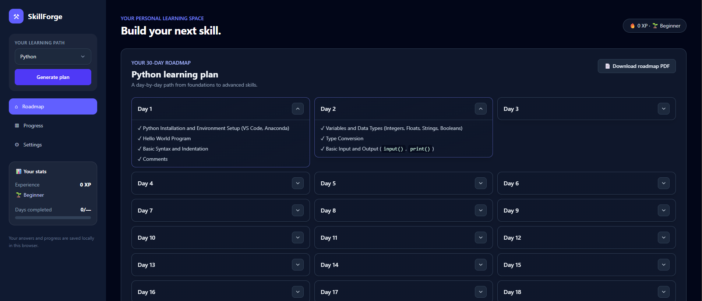
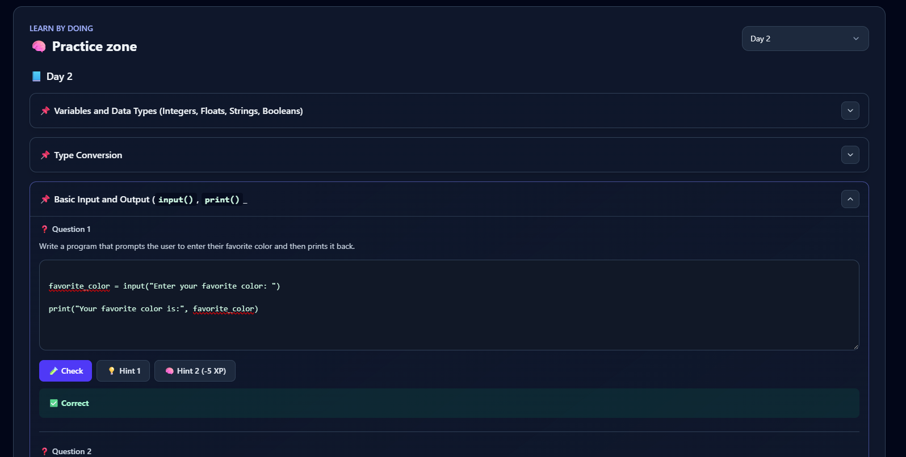
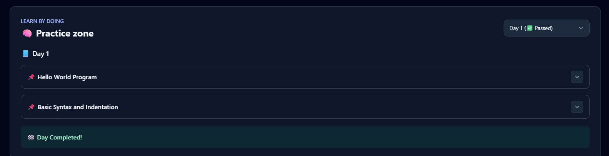
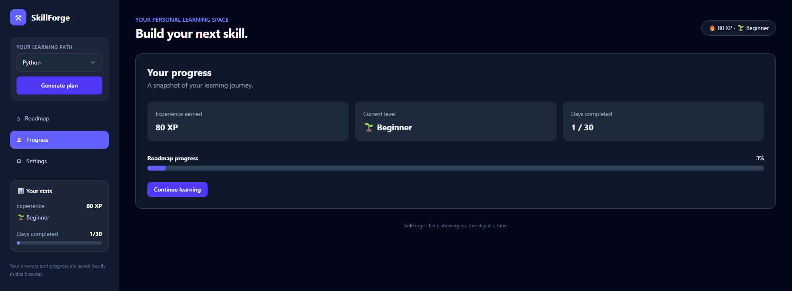
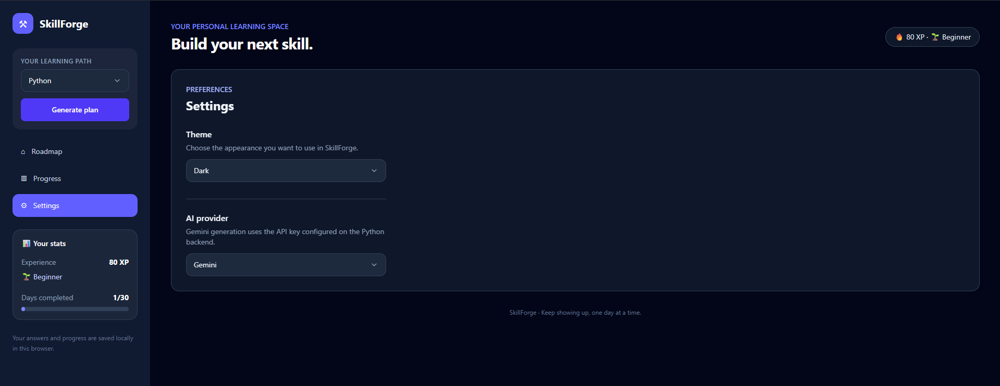

# 🚀 SkillForge – AI Powered 30-Day Coding Learning Platform

---

## 📌 Short Description

SkillForge is an interactive coding practice platform with a React + TypeScript frontend and a Python FastAPI backend. It creates a personalized 30-day learning roadmap, generates practice questions, evaluates submitted answers, and tracks progress in the browser. AI generation can use a local OpenAI-compatible model through LM Studio or Google Gemini.

---

## 🌐 Website Demo Link

### ⚠️ Note

SkillForge uses large language models to dynamically generate personalized learning roadmaps, practice questions, hints, and code evaluation feedback.

Because content is generated in real time, actions such as roadmap generation and practice question generation may take a few seconds. Avoid repeatedly clicking generation buttons while a request is in progress.

### 🔗 Demo Access

If a live demo of the web app is available, the access link will be provided in the **GitHub repository “About” section (top-right side of the repository page)**.

If no link is shown in the About section, it means the live version is currently not deployed or temporarily unavailable.

The full source code and setup instructions are still available in this repository for local execution.

---

## 🧠 What This Project Does

SkillForge turns a learning roadmap into an interactive coding experience:

- Choose Python, JavaScript, Java, C++, or Go.
- Generate a structured 30-day roadmap and day-by-day practice questions.
- Answer coding questions in the browser and receive AI feedback with explanations and suggested fixes.
- Request hints. Hint 2 costs 5 XP once per question.
- Earn XP for correct answers and complete practical days.
- Track completed practical days, XP, and level progression. Theory-only days do not count toward the completed-day total.
- Download the roadmap as a PDF.
- Switch between local LM Studio generation and Gemini in Settings.

---

## 🧱 Application Architecture

The project is split into a React frontend and a Python API backend:

### React frontend (`frontend/`)

- React, TypeScript, Vite, and Tailwind CSS provide the browser UI.
- React Router manages the **Roadmap**, **Progress**, and **Settings** pages.
- Reusable components handle navigation, dropdowns, practice questions, feedback, and notifications.
- The selected theme and AI provider are saved in browser local storage. Learning progress, answers, hints, and XP are also saved in local storage.

### Python backend (`src/`)

- FastAPI exposes the `/api` endpoints consumed by the frontend.
- `src/skillforge/api/` contains the request schemas and route handlers.
- `src/skillforge/services/` contains AI generation, validation, PDF creation, and gamification logic.
- `src/skillforge/config.py` loads backend settings from environment variables and the root `.env` file.

The frontend sends JSON requests to the backend. In development, Vite proxies `/api` requests to `http://localhost:8000`. In a production build, FastAPI serves the built frontend from `frontend/dist` when that directory exists.

### API routes

| Method | Route                          | Purpose                                     |
| ------ | ------------------------------ | ------------------------------------------- |
| `POST` | `/api/roadmap`                 | Generate a roadmap                          |
| `POST` | `/api/practice`                | Generate practice questions for the roadmap |
| `POST` | `/api/evaluate`                | Evaluate a submitted answer                 |
| `POST` | `/api/hint`                    | Generate a hint                             |
| `POST` | `/api/gamification/completion` | Calculate day completion rewards            |
| `POST` | `/api/gamification/level`      | Get the level for an XP total               |
| `POST` | `/api/roadmap/pdf`             | Create a downloadable roadmap PDF           |

---

## 🐍 How Python Is Used

Python runs the backend API and business logic. It validates requests and generated plans, calls the selected AI provider, evaluates answers, calculates XP and achievements, and creates roadmap PDFs. The browser UI and browser-stored user progress are handled by the React frontend.

### 🤖 AI Providers

The AI provider can be selected on the **Settings** page. The choice is saved in browser local storage and sent with AI requests.

- **Local AI (default):** Uses an OpenAI-compatible endpoint. LM Studio can provide this endpoint; start its local server and load the configured model before generating content.
- **Gemini:** Uses the Google Gemini API key configured for the Python backend.

Default configuration:

| Variable            | Default                     | Purpose                                          |
| ------------------- | --------------------------- | ------------------------------------------------ |
| `LOCAL_AI_BASE_URL` | `http://localhost:1234/v1`  | OpenAI-compatible local API URL                  |
| `LOCAL_AI_MODEL`    | `qwen2.5-coder-7b-instruct` | Local model name                                 |
| `GEMINI_API_KEY`    | —                           | Gemini API key; required when Gemini is selected |
| `GEMINI_MODEL`      | `gemini-2.5-flash`          | Gemini model name                                |

---

## 🧩 Challenges Faced, Solutions & Learnings

During the development of this project, one of the main challenges was connecting the backend logic with the Streamlit frontend. Since this was my first time building a full application using Streamlit, it initially took some time to understand how Streamlit’s execution model and `session_state` work together to manage dynamic UI updates and persistent data.

Another difficulty was adapting certain features to fit within Streamlit’s limitations, especially around real-time updates, state persistence, and interactive components. Instead of forcing traditional frontend patterns, I had to rethink and redesign parts of the application to align with Streamlit’s reactive nature.

### 🛠️ How I solved it

I solved these issues by designing the application architecture around Streamlit’s constraints rather than against them. This included:

- Relying heavily on `st.session_state` for persistent data flow
- Structuring UI updates to work with Streamlit’s rerun behavior
- Breaking features into modular logic that fits Streamlit’s execution cycle
- Iteratively testing and adjusting interactions to behave as expected in a reactive environment

### 📚 What I learned

This project helped me gain strong practical experience with Streamlit and reactive Python-based UI development. I learned how to quickly build and ship full-stack prototypes using only Python, and how to design applications that work naturally within Streamlit’s architecture.

Most importantly, I discovered how powerful Streamlit can be for rapidly turning backend logic into a functional and interactive frontend, which will significantly speed up my future projects and prototyping workflows.

---

### 🤖 Prompt Engineering & LLM Reliability

This project uses structured prompts for AI-generated learning plans, practice questions, answer evaluation, and hints. The prompts and Python validation logic are designed to encourage:

- Structured JSON outputs for roadmap and practice generation
- Consistent use of the selected programming language
- A progression from beginner to advanced topics
- Curriculum topics that stay within the requested learning plan
- Response formats that the backend can parse and validate

Practice generation retries invalid responses before returning an error. The backend supports both the local OpenAI-compatible provider and Gemini, selected by the frontend for each request.

---

## 🖼️ Screenshots







---

## ⚙️ Key Features

### 🎯 AI-Generated Learning Roadmap

- Generates a structured 30-day coding plan for the selected language.
- Presents day content in expandable dropdowns.

### 💻 Interactive Coding Practice

- Generates questions for roadmap topics.
- Accepts code answers in the browser and shows formatted evaluation feedback.

### 🤖 AI Code Evaluation

- Checks submitted solutions using the configured AI provider.
- Returns correctness, explanation, and suggested fixes.

### 🧠 Practice Question Generator

- Generates practical coding exercises for each day and topic.
- Theory-only days remain available in the plan and are excluded from practical-day completion progress.

### 💡 Hint System

- Provides two levels of AI-generated hints.
- Hint 2 costs 5 XP once per question.

### 🏆 Gamification System

- Awards XP for correct answers and completion achievements.
- Plays completion sounds for day and achievement milestones.

### 📊 Progress Page

- Shows XP, current level, and completed practical days.
- Calculates the total from days in the generated practice plan that contain questions.

### ⚙️ Settings Page

- Switches between dark and light themes.
- Selects the local AI or Gemini provider.
- Saves theme and provider preferences in browser local storage.

### 📄 PDF Export

- Generates and downloads a PDF copy of the roadmap.

---

### 🏆 XP Rewards

| Action                                  |           XP |
| --------------------------------------- | -----------: |
| Correctly solve a coding question       |       +10 XP |
| Complete the first practical day        | +10 XP bonus |
| Complete all practical days in the plan | +50 XP bonus |

### 💡 XP Costs

| Action                         | XP Cost |
| ------------------------------ | ------: |
| Use Hint 2 (once per question) |   -5 XP |

### 📈 Level Progression

| Level                | XP Required |
| -------------------- | ----------: |
| 🌱 Beginner          |     0–99 XP |
| ⚡ Apprentice        |  100–299 XP |
| 🔥 Intermediate      |  300–599 XP |
| 🚀 Advanced          |  600–999 XP |
| 👑 SkillForge Master |    1000+ XP |

### 🎯 Progress Tracking

Learning progress, answers, hints, and XP are saved in the browser’s local storage. Completed-day progress counts practical days with questions, so a plan’s maximum can be lower than 30 when it includes theory-only days. SkillForge does not currently use a database for user progress.

---

## ▶️ How to Run

### Requirements

- Python 3.12 or newer
- Node.js 24 (also used by the frontend Docker build)
- LM Studio with a compatible model and its local server running, or a Gemini API key

### Option 1 — Run in Development

#### 1. Install Python dependencies

From the repository root:

```bash
python -m venv .venv
```

Activate the environment, then install dependencies:

```bash
# Windows PowerShell
.venv\Scripts\Activate.ps1

# macOS/Linux
source .venv/bin/activate

pip install -r requirements.txt
```

#### 2. Configure AI settings

Local AI is the default. Start LM Studio’s local server at `http://localhost:1234` and load the model configured by `LOCAL_AI_MODEL`.

To use Gemini, create a `.env` file in the repository root:

```env
GEMINI_API_KEY=your_api_key_here
```

Optional settings can also be added to `.env`:

```env
GEMINI_MODEL=gemini-2.5-flash
LOCAL_AI_BASE_URL=http://localhost:1234/v1
LOCAL_AI_MODEL=qwen2.5-coder-7b-instruct
```

#### 3. Install frontend dependencies

```bash
cd frontend
npm install
```

#### 4. Start the backend and frontend

Open two terminals at the repository root.

Terminal 1 — Python API:

```bash
uvicorn main:app --app-dir src --reload --host 127.0.0.1 --port 8000
```

Terminal 2 — React development server:

```bash
cd frontend
npm run dev
```

Open the Vite URL shown in the terminal (usually `http://localhost:5173`). Vite forwards API requests to the backend at `http://localhost:8000`.

### Option 2 — Build and run the application

Build the frontend:

```bash
cd frontend
npm install
npm run build
```

From the repository root, start FastAPI:

```bash
uvicorn main:app --app-dir src --host 127.0.0.1 --port 8000
```

When `frontend/dist` exists, FastAPI serves the built frontend and API from `http://localhost:8000`.

### Option 3 — Run with Docker

Create a root `.env` file before starting Compose. You can leave it empty when using the default local provider. Add the Gemini key if you plan to select Gemini:

```env
GEMINI_API_KEY=your_api_key_here
```

Then build and start the application:

```bash
docker compose up --build
```

The app and API will be available at `http://localhost:8000`.

If you want a Dockerized backend to access LM Studio running on the host computer, set `LOCAL_AI_BASE_URL` to `http://host.docker.internal:1234/v1` in `.env` and make sure the LM Studio server accepts connections from Docker.

---

## 🧪 Testing & Code Quality

The backend unit tests do not call an AI provider. From the repository root, install the development tools and run the checks:

```bash
pip install ruff
ruff format .
ruff check --fix .
ruff check .
```

To check the frontend:

```bash
npm run lint
npx prettier --write "frontend/src/**/*.{ts,tsx,css}"
```

---

## ⚠️ Important Notes

- AI generation requires either a reachable local model server or a valid Gemini API key, depending on the provider selected in Settings.
- Local AI is the default provider. LM Studio must be running with the configured model loaded.
- Gemini credentials are read by the Python backend from `GEMINI_API_KEY` in the environment or root `.env` file.
- The selected theme, AI provider, answers, hints, XP, and learning progress are stored in browser local storage.
- Generated roadmap and practice data are held in the running frontend session; generating a new roadmap resets learning progress.
- There is no user account or database-backed progress sync.

---

## 🏆 Project Highlights

- React + TypeScript frontend with a Python FastAPI backend
- Local LM Studio and Gemini AI provider options
- AI-generated learning plans, practice questions, feedback, and hints
- Progress, theme, and AI provider preferences stored in the browser
- Practical-day completion tracking, gamification, and roadmap PDF export

---

## 👤 Author

Built and maintained by [@Jienniers](https://github.com/Jienniers)

---

Stay tuned for updates and releases of **SkillForge**!

Feel free to ⭐ the repository if you find it useful!
